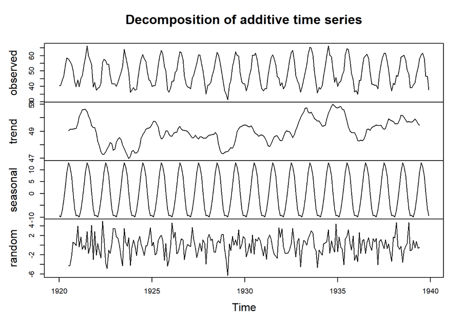
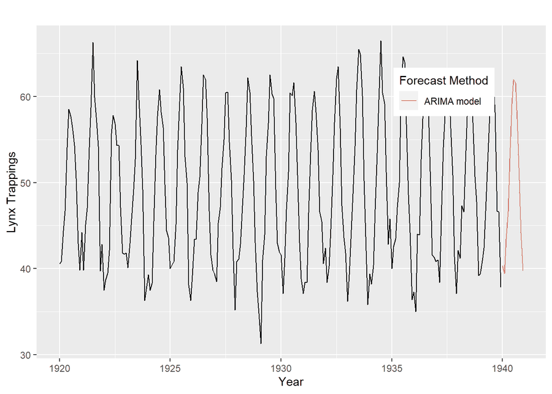

# Zaman Serileri Analizine Giriş

Zaman serisi analizinin temel kavramlarını R örnekleriyle anlatan Türkçe bir giriş çalışması:
bileşenlere ayırma, durağanlık, otokorelasyon ve ARIMA modelleriyle tahmin.

**Rapor:** [`Zaman-Serileri-Analizi-Giris/ZSA.html`](Zaman-Serileri-Analizi-Giris/ZSA.html)
dosyasını indirip tarayıcıda aç.




## İçerik

| Bölüm | Konular |
|---|---|
| Zaman serisi analizleri | Yöntemler, bileşenler (trend, mevsimsellik, rassal bileşen), süreçler |
| Varsayımlar | Durağanlık, rassal yürüyüş, akgürültü, otokorelasyon ve korelogram (ACF, PACF), birim kök (ADF testi) |
| Modeller | AR(p), MA(q), ARMA(p,q), ARIMA(p,d,q), `auto.arima()` ile model seçimi ve tahmin |

## Çalıştırma

```r
rmarkdown::render("Zaman-Serileri-Analizi-Giris/ZSA.Rmd")
```

Paketler: `forecast`, `tseries`, `zoo`, `tidyverse`.

## Veri

R ile birlikte gelen veri setleri kullanılır, ek dosya gerekmez: `nottem` (Nottingham aylık
ortalama sıcaklıkları, 1920–1939), `AirPassengers`, `JohnsonJohnson`.
